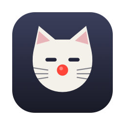
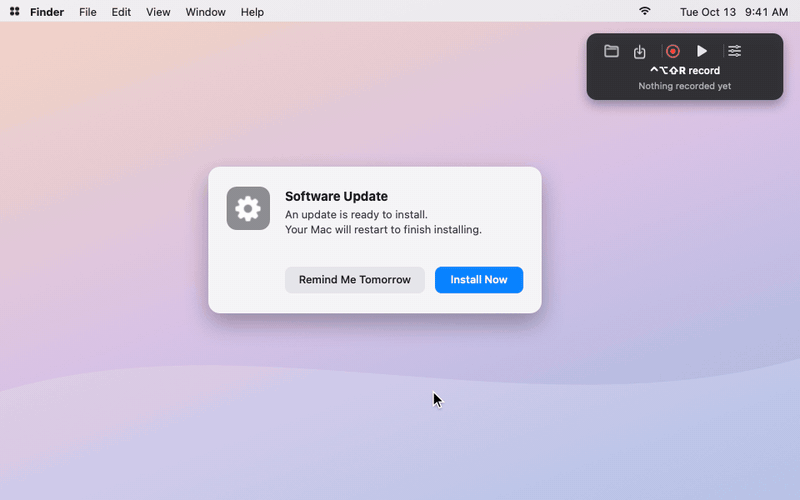
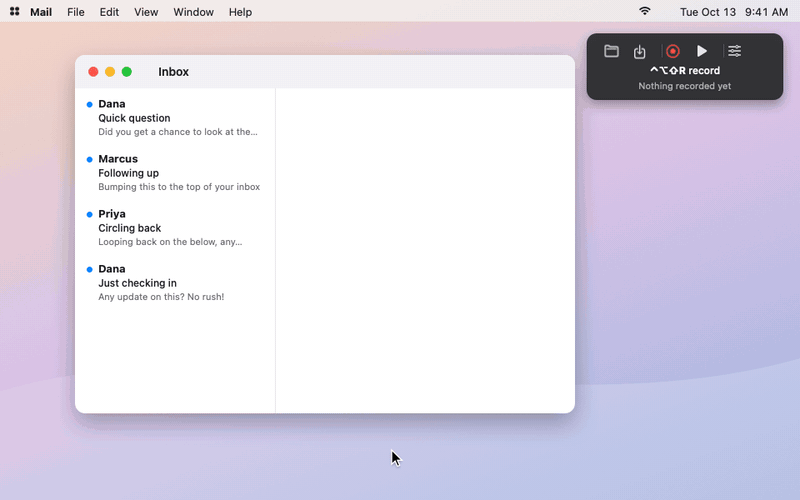

<p align="center"></p>

# Replicat

A tiny macro recorder for macOS. Record your mouse and keyboard once, then
replay it at any speed, as many times as you like. If you used TinyTask on
Windows, this is that, for Mac.



- **Two hotkeys:** ⌃⌥⇧R records and ⌃⌥⇧P plays, the same chords TinyTask uses.
- **Any speed:** 1.34× is fine. Repeat a set number of times or until you stop it.
- **Hard to lose control of:** Esc, nudging the mouse, or clicking stops playback.
- **Small:** one Swift file, a ~0.5 MB app, one permission (Accessibility),
  no account, no network access.

## Install

Requires macOS 14 or later and the Xcode Command Line Tools
(`xcode-select --install`).

```sh
git clone https://github.com/ja-godfrey/replicat.git
cd replicat
./build.sh            # builds and installs ~/Applications/Replicat.app
open ~/Applications/Replicat.app
```

On first launch, macOS asks you to allow Replicat under **System Settings ›
Privacy & Security › Accessibility**. Turn it on; the toolbar notices by itself.

`build.sh` signs the app ad hoc, so macOS asks you to re-enable Accessibility
after every rebuild. To avoid that, run `./make-signing-identity.sh` once. It
makes a local self-signed certificate (nothing leaves your Mac), and later
builds use it automatically.

## Use

| Key | Does |
| --- | --- |
| ⌃⌥⇧R | Start / stop recording |
| ⌃⌥⇧P | Start / stop playback |
| Esc | Stop playback (also: move the mouse or click) |

The floating toolbar shows the keys that matter for what you're doing right
now. It turns red while recording and green while playing, with a progress line
along the bottom. A menu-bar icon mirrors the state; one click on it stops
whatever is running.



The settings button (sliders icon) holds:

- **Speed:** ½×, 1×, 2×, 4×, 10×, 100×, or **Custom…** for any number from
  0.01 to 1000.
- **Repeat:** once, 2–100 times, or continuously.
- **Trim to first and last click or key** (on by default). This drops the idle
  travel before your first action and after your last one, such as moving to
  the Stop button. The full recording is kept, so turning trim off brings it
  back. Pauses in the middle are always kept.
- **Stop when I move the mouse or click** (on by default). Esc always stops.
- **3-2-1 countdown before playing.**

Recordings save as `.replicat` files (Open/Save in the toolbar, or
double-click a file). The latest one is kept automatically and reloads at
launch.

### Safety

- Replicat tags every event it posts, so playback is never re-recorded and never
  trips the stop-on-mouse-move check. Only your real hand on the mouse does.
- The hotkeys and clicks on Replicat's own toolbar and menu-bar icon are left
  out of recordings.
- Each recording remembers the screen layout it was made on. If you play it on
  a different one (say, an external display is off), Replicat warns you and
  says how many clicks would land off-screen before anything moves.
- If playback stops mid-shortcut, held modifier keys are released.

## How it compares

As of October 2026, from each vendor's own site or App Store listing. Prices
change; corrections welcome.

| Tool | Runs on Mac | Price | Open source | Playback speed | Stands out for |
| --- | --- | --- | --- | --- | --- |
| **Replicat** | ✅ macOS 14+ | Free | ✅ MIT | Any multiplier | Tiny; stops when you touch the mouse; screen-layout check |
| [TinyRecorder](https://github.com/Aaru1801/TinyTask-macOS) | ✅ macOS 14+ | Free | ✅ MIT | 0.5×–4× | Timeline editor, per-macro hotkeys, imports TinyTask `.rec` |
| [Ghost Input](https://www.gtrigonakis.com/ghost-input) | ✅ macOS 13.6+ | $5.99 | – | 0.5×–10× | Step timeline, Shortcuts integration |
| [MacroLoop](https://apps.apple.com/us/app/macroloop/id6756636709) | ✅ macOS 15.6+ | Free, in-app purchases | – | 0.5×–2× | Scheduling, playback history |
| [ClickMimic](https://clickmimic.app/) | ✅ macOS 12+ | $10/mo or $70/yr | – | not stated | Scheduling, human-like timing |
| [Macro Recorder](https://www.macrorecorder.com/) | ✅ and Windows | Free for personal use; paid editions | – | ✓ | Step editor; image and text recognition in paid editions |
| [Keyboard Maestro](https://www.keyboardmaestro.com/) | ✅ | $36 | – | not stated | Full automation suite; records clicks and keys as editable actions |
| [Automator](https://support.apple.com/guide/automator/create-workflows-aut7cac58839/mac) | ✅ built in | Free | – | not stated | Built in ("Watch Me Do" recording) |
| [Hammerspoon](https://www.hammerspoon.org/) | ✅ | Free | ✅ MIT | scripted | Lua scripting for everything; no built-in recorder |
| [TinyTask](https://tinytask.net/) | Windows only | Free | – | ✓ | The original; 36 KB; compiles macros to `.exe` |

**Pick something else if you need:**
- To edit individual steps: TinyRecorder, Ghost Input or Macro Recorder.
- Clicks that find a button wherever it is on screen (image or text matching):
  Macro Recorder or Keyboard Maestro.
- Real automation logic (conditions, variables, scripting): Keyboard Maestro or
  Hammerspoon.

Replicat is for the TinyTask job: do it once, then have it done again.

## Limits

- Clicks replay at the same screen positions. Move or resize a window and the
  clicks won't follow it.
- macOS hides keystrokes typed into password fields (Secure Input), so those
  aren't recorded.
- There's no step editor and no "compile to app". To use a macro, open its
  `.replicat` file and press ⌃⌥⇧P.

## Privacy

Replicat makes no network connections and collects nothing. Recordings stay in
the files you save and in `~/Library/Application Support/Replicat/`. A short
log of toolbar window events, for debugging, goes to
`~/Library/Logs/Replicat.log`.

## Customize

The ring drawn around the selected toolbar uses your system accent colour. To
match your own window-border tool:

```sh
defaults write io.github.ja-godfrey.replicat focusRingColor "#e06c75"
```

## Demos

The GIFs are AppKit recreations, not screen recordings. The desktop, dialog and
mail app are made up, and the toolbar is redrawn to match the app. Regenerate
them with `./demo/render.sh` (needs `ffmpeg`).

## License

MIT. See [LICENSE](LICENSE).
